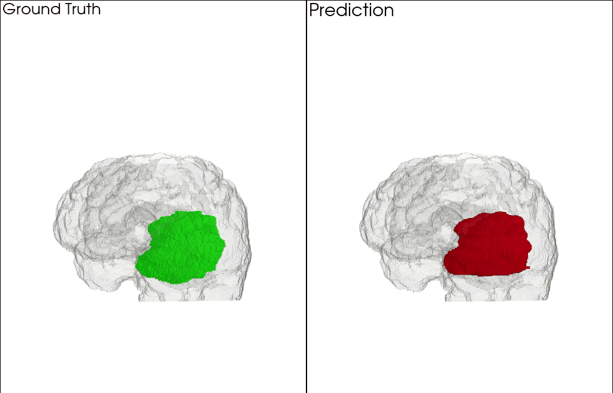

# 🧠 Brain Tumor Segmentation (BraTS 2019)


> *3D visualization of the segmented tumor (red) vs. ground truth (green) inside the brain volume.*

Whole-tumor segmentation on multi-modal MRI with a 2D U-Net, trained slice-wise
and evaluated per patient on the full 3D volume.

## Pipeline

| Step | Script | What it does |
|---|---|---|
| Preprocess | `src/preprocess.py` | Loads FLAIR, T1ce, T1, T2 + segmentation, z-score normalizes **per volume** (brain voxels only), saves 2D slices as `.npy` (4 × 240 × 240). Label = whole tumor (all BraTS labels > 0). |
| Split | `src/splits.py` | **Patient-level** train / val / test split (default 80/10/10, seed 42), stored in `data/splits.json`. Created automatically on first training run. |
| Train | `src/train.py` | U-Net, BCE + Dice loss, Adam. Validation = mean 3D Dice over validation patients. Saves `best_model.pth` / `last_model.pth`. |
| Evaluate | `src/evaluate.py` | 3D Dice per test patient (mean, std, median, worst case) + CSV. |
| Inspect | `src/predict.py`, `src/visualize_3d.py` | 2D slice view with confidence map / 3D render with PyVista — both on held-out test patients. |

### Why patient-level split and 3D Dice?
Neighbouring slices of one patient are almost identical. A random split over
slices puts the same anatomy into train and validation and overestimates
performance. Dice averaged over 2D batches is also biased: empty slices score
≈ 1 through the smoothing term. Both are fixed here; scores are therefore
comparable to how BraTS reports whole-tumor Dice.

## Usage

```bash
pip install -r requirements.txt

# BraTS 2019 training data → data/MICCAI_BraTS_2019_Data_Training/{HGG,LGG}/...
python -m src.preprocess
python -m src.train --epochs 20 --batch_size 16
python -m src.evaluate --subset test
python -m src.visualize_3d               # optional: --patient <ID>
```

Tests (synthetic data, no download needed):

```bash
python -m pytest tests/
```

## Results

| Model | Input | Whole-tumor Dice (test, 3D) |
|---|---|---|
| 2D U-Net | FLAIR, T1ce, T1, T2 | _tbd_ |

## Roadmap
- [ ] Multi-class BraTS regions (WT / TC / ET) + HD95
- [ ] Augmentation, LR scheduler, mixed precision
- [ ] 3D / 2.5D U-Net
- [ ] Transformer backbone (Swin UNETR) vs. U-Net baseline
- [ ] nnU-Net reference
